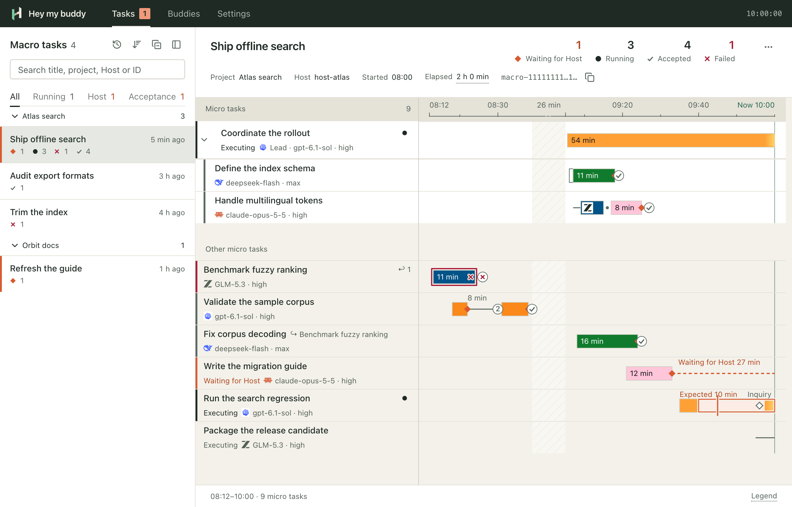
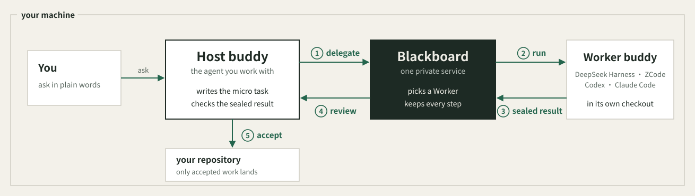

<p align="right"><strong>English</strong> · <a href="README.zh-CN.md">简体中文</a></p>

<picture>
  <source media="(prefers-color-scheme: dark)" srcset="docs/assets/banner-dark.svg">
  
</picture>

<p align="center"><b>Delegate the work. Keep the responsibility.</b></p>

<p align="center">
  The coding agent you work with hands bounded tasks to other coding agents on your machine,<br>
  and checks every sealed result before it lands.
</p>

<p align="center">
  <a href="#how-it-works">How it works</a> ·
  <a href="#install">Install</a> ·
  <a href="#first-steps">First steps</a> ·
  <a href="#status-and-limits">Status</a> ·
  <a href="#documentation">Docs</a>
</p>

---

## What is hey-my-buddy

hey-my-buddy lets the coding agent you already work with hand parts of its work to other coding agents on your machine, and check each result before it lands.

- **Your agent stays in charge.** The coding agent you work with is the *Host buddy*: it splits the work, hands bounded parts to other agents and decides what is accepted. Any agent that can run the hey-my-buddy command can be the Host.
- **Other agents do the parts.** A *Worker buddy* is a coding agent in the CLI of DeepSeek Harness, ZCode, Codex or Claude Code, with the models and efforts you enabled. hey-my-buddy picks one for each part, or the Host names it.
- **Nothing lands unchecked.** Each Worker works in its own checkout of your repository, and the Host reviews the result and runs the checks before anything reaches your branch.
- **Work outlives your session.** A closed terminal, a lost connection or a service restart never cancels work; pick it up again by its id.
- **See who is doing what.** A private local console shows each piece of work as a timeline, every buddy's load and your settings.
- **Your accounts, your plans.** Workers sign in with your own harness accounts; hey-my-buddy never keeps or forwards your credentials. See [accounts and terms](docs/terms.md).

<picture>
  <source media="(prefers-color-scheme: dark)" srcset="docs/assets/console-timeline-en-dark.png">
  
</picture>

## How it works

<picture>
  <source media="(prefers-color-scheme: dark)" srcset="docs/assets/overview-en-dark.svg">
  
</picture>

1. **Delegate.** The Host writes a *micro task*: what to do, which files it may change and how to check it. It hands the micro task to the *blackboard*, a local service that keeps every step.
2. **Run.** The blackboard picks a Worker: the only one that fits, or a *Router buddy*'s choice among several, unless the Host names one. The Worker works in its own checkout. The Host can ask the running turn a question; when the Worker needs a decision, it stops and asks.
3. **Seal.** When the turn ends, the blackboard seals the checkout as it stood, so the result cannot change afterwards.
4. **Review.** The Host checks the sealed result against the micro task and runs the checks. If it is not right, the Host sends it back to the same Worker for another turn.
5. **Accept.** The Host integrates the result and accepts it; only accepted work lands in your repository.

Related micro tasks form a *macro task*. The details, including Lead buddies that delegate on the Host's behalf, are in [workflow](docs/reference/workflow.md) and [architecture](docs/reference/architecture.md).

## Install

It needs [uv](https://docs.astral.sh/uv/).

```sh
uvx hey-my-buddy@0.60.1 install
```

This installs one agent skill at `~/.agents/skills/hey-my-buddy`, which carries its own launcher, and a private service under `~/.local/share/hey-my-buddy` (`%LOCALAPPDATA%\hey-my-buddy` on Windows). It also links the skill at `~/.claude/skills/hey-my-buddy`, where Claude Code looks for skills. It never changes your `PATH`, shell or agent settings.

To install from a checkout of this repository instead, build the wheel and install it:

```sh
uv build --wheel --out-dir dist
uvx --from "$PWD/dist/hey_my_buddy-0.60.1-py3-none-any.whl" hey-my-buddy install
```

<details>
<summary>Or let your agent install it</summary>

```text
Install hey-my-buddy on this machine for me.

1. Use the version I name, or the wheel I give you.
2. Run the install outside your sandbox through your own permission mechanism, without sudo.
3. Before it writes anything, list every path it will create or replace.
4. Report the skill version and place, the Claude Code link, the service action and whether a backup was taken.
5. Verify with ~/.agents/skills/hey-my-buddy/scripts/hey-my-buddy health.
6. On LAUNCH_ACCESS_DENIED, allow that exact launcher command and retry. On UPGRADE_NOT_IDLE, report the listed work and wait; never cancel work to force an upgrade.
```

</details>

Upgrading runs the same command with the newer version. An upgrade that changes the contract refuses while work is running and takes a verified backup before it switches. [Operations](docs/reference/operations.md#installation) has the details, error codes and recovery.

## First steps

Ask your Host buddy in plain words, for example:

> Use hey-my-buddy to have a buddy check the links in this README and report the broken ones.

The skill tells the Host the rest. To look around yourself:

```sh
~/.agents/skills/hey-my-buddy/scripts/hey-my-buddy health    # routing and capacity
~/.agents/skills/hey-my-buddy/scripts/hey-my-buddy console   # open the private console
```

In the console, enable the buddies you want to work with and set how many may run at once. [Usage](docs/reference/usage.md) walks from install to a reviewed result; the [CLI reference](docs/reference/cli.md) covers every command.

## Status and limits

- **0.x.** While the version is 0.x the contract can change between middle versions; such an upgrade converts your board in one explicit, backed-up step.
- **Platforms.** macOS, Linux and Windows 11 (x64 and ARM64).
- **Harnesses.** Workers run in the CLI of DeepSeek Harness, ZCode, Codex or Claude Code. What each supports, and how far it is verified on each platform, is in [harnesses](docs/reference/harnesses.md).
- **Accounts and terms.** hey-my-buddy works with your own harness accounts and plans. What it does with them, where your task text goes and which terms apply are in [accounts and terms](docs/terms.md).

## Documentation

- [Documentation index](docs/README.md)
- [Operations](docs/reference/operations.md): install, upgrade, storage, error codes and recovery
- [Usage](docs/reference/usage.md) and [CLI](docs/reference/cli.md)
- [Console](docs/reference/console.md) and [harnesses](docs/reference/harnesses.md)
- [Architecture](docs/reference/architecture.md) and [decisions](docs/decisions/)

## Development

```sh
npm --prefix apps/console ci
uv run --frozen python -m hey_my_buddy.cli.checks
npm --prefix apps/console test
```

[AGENTS.md](AGENTS.md) covers the repository's invariants, layout and checks. Report problems in [GitHub issues](https://github.com/Dsssyc/hey-my-buddy/issues).

## License

[MIT](LICENSE)
