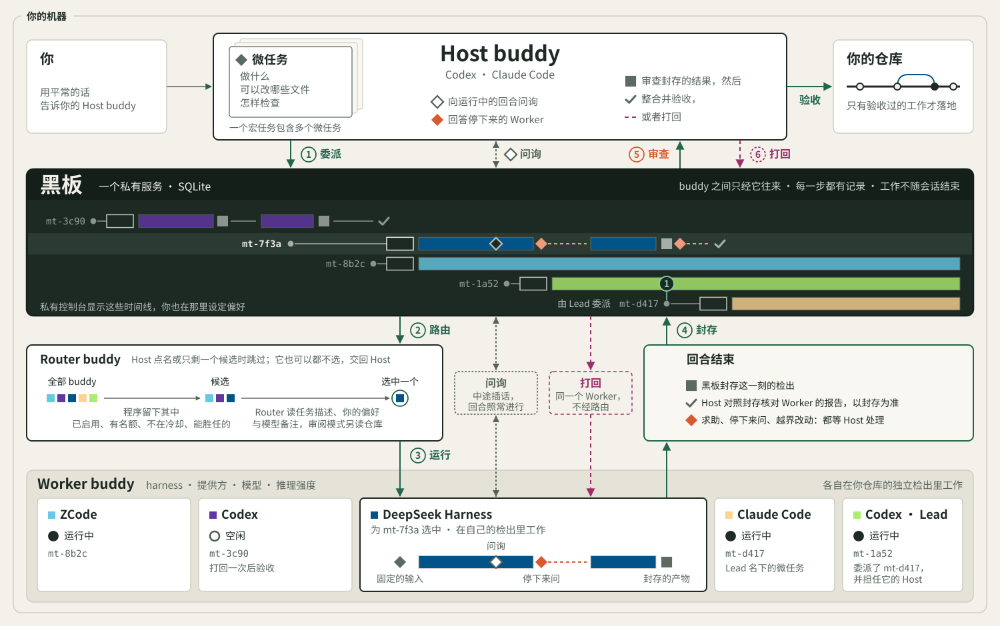

<p align="right"><a href="README.md">English</a> · <strong>简体中文</strong></p>

<picture>
  <source media="(prefers-color-scheme: dark)" srcset="docs/assets/banner-dark.svg">
  
</picture>

<p align="center"><b>工作委派出去，责任留在自己手里。</b></p>

<p align="center">
  你正在用的编码 agent 把边界明确的任务交给本机的其他编码 agent，<br>
  每一份封存的结果都由它核对之后才落地。
</p>

<p align="center">
  <a href="#怎样工作">怎样工作</a> ·
  <a href="#安装">安装</a> ·
  <a href="#开始使用">开始使用</a> ·
  <a href="#现状与限制">现状</a> ·
  <a href="#文档">文档</a>
</p>

---

## 为什么用 hey-my-buddy

- **你信任的 agent 始终做主。** 你平常用的编码 agent（例如 Codex 或 Claude Code）就是你的 Host buddy：它拆分工作、把边界明确的部分委派出去，每一份结果都由它自己验收。
- **每一部分交给合适的 buddy。** Worker 在 DeepSeek Harness、ZCode、Codex 或 Claude Code 里运行，用的是你启用的模型与推理强度；由路由来选，或者由 Host 指定。
- **没有核对过的东西不会落地。** 每个微任务在自己的检出里工作，输入固定、产物封存；Host 读过差异、跑过检查之后才验收。
- **工作比你的会话活得久。** 终端关掉、连接断开、服务重启都不会取消工作；凭它的标识接着处理。
- **看得见谁在做什么。** 本机私有的控制台把每个宏任务画成一条时间线，显示每个 buddy 的负载与你的设置。
- **用你自己的账户与套餐。** Worker 用你自己的 harness 账户登录，hey-my-buddy 从不保存也不转交你的凭据。见[账户与条款](docs/terms.zh-CN.md)。

## 怎样工作

<picture>
  <source media="(prefers-color-scheme: dark)" srcset="docs/assets/architecture-zh-dark.svg">
  
</picture>

1. **委派。** Host 写一个微任务：做什么、可以改哪些文件、怎样检查。除非 Host 点名，由 Router buddy 选出一个 buddy。
2. **执行。** Worker 在自己的 harness 与检出里工作。Host 可以经黑板向运行中的回合问询，回合不必停下；Worker 需要决定或帮助时，它停下来提问，Host 回答，或者让它接着做。
3. **验收。** Host 审查封存的结果：要么整合并验收，验收会核对这次整合并回收检出；要么打回给同一个微任务再跑一个回合；放弃的工作以结论结束。

微任务、决定与结果都记在本地的黑板上，黑板是一个由私有服务独占的 SQLite 数据库。详见[工作流](docs/reference/workflow.md)与[架构](docs/reference/architecture.md)。

## 安装

hey-my-buddy 是一个共享的 agent skill，装在 `~/.agents/skills/hey-my-buddy`，自带启动器；私有的服务与运行时在 `~/.local/share/hey-my-buddy` 之下。Claude Code 通过 `~/.claude/skills/hey-my-buddy` 这个链接找到它。安装不改你的 `PATH`、shell 与 agent 设置。需要 [uv](https://docs.astral.sh/uv/)。

现在还没有发布。从这个仓库构建 wheel 再安装：

```sh
uv build --wheel --out-dir dist
uvx --from "$PWD/dist/hey_my_buddy-0.54.0-py3-none-any.whl" hey-my-buddy install
```

发布之后，同样的安装只要一条命令：

```sh
uvx hey-my-buddy@0.54.0 install
```

<details>
<summary>或者让你的 agent 来装</summary>

```text
请在这台机器上为我安装 hey-my-buddy。

1. 用我给的发布版本或 wheel；不要假定它已经在 PyPI 上。
2. 在你的沙盒之外、经你自己的权限机制运行安装，不用 sudo。
3. 写入任何东西之前，列出它将创建或替换的每一个路径。
4. 报告 skill 的版本与位置、Claude Code 的链接、服务的动作，以及有没有做备份。
5. 用 ~/.agents/skills/hey-my-buddy/scripts/hey-my-buddy health 核对。
6. 遇到 LAUNCH_ACCESS_DENIED，只放行这一条启动器命令再试；遇到 UPGRADE_NOT_IDLE，报告列出的工作并等待，绝不为了强行升级去取消工作。
```

</details>

升级用同一条命令，换成新版本。改动契约的升级在有工作运行时拒绝，切换之前先做一份核对过的备份。细节、错误码与恢复见[运维](docs/reference/operations.md#installation)。

## 开始使用

用平常的话告诉你的 Host buddy，例如：

> 用 hey-my-buddy 让一个 buddy 检查这份 README 里的链接，报告坏掉的那些。

其余的由 skill 告诉 Host。想自己看看：

```sh
~/.agents/skills/hey-my-buddy/scripts/hey-my-buddy health    # 路由与容量
~/.agents/skills/hey-my-buddy/scripts/hey-my-buddy console   # 打开私有控制台
```

在控制台里启用你想用的 buddy，并设定同时能跑几个。[用法](docs/reference/usage.md)从安装一路讲到验收结果；[命令行参考](docs/reference/cli.md)覆盖每一条命令。

## 现状与限制

- **尚未发布。** 还没有任何发布版本；版本号是 0.x 期间，契约可以在中间那位数字变动时改变。
- **平台。** 每天在 macOS 上使用；完整的测试套件在 Linux 的持续集成上通过。Windows 11（x64 与 ARM64）的支持正在为首次发布做最后的准备。
- **Harness。** Codex 经它的实验性 App Server 运行。各个 harness 支持什么、验证到哪一步，见[harness](docs/reference/harnesses.md)。
- **路由会看到任务。** 由路由来选 buddy 时，任务的文字会发给 Router 所在的模型供应方，即使最后做事的是别的模型。
- **不是沙盒。** 检出与私有目录把工作隔开，但它们不是操作系统的沙盒；Worker 拥有它的 harness 给它的权限。
- **不管花费。** 用量计入你自己的套餐与密钥；hey-my-buddy 不记录金额。

## 文档

- [文档索引](docs/README.md)
- [运维](docs/reference/operations.md)：安装、升级、存储、错误码与恢复
- [用法](docs/reference/usage.md)与[命令行](docs/reference/cli.md)
- [控制台](docs/reference/console.md)与[harness](docs/reference/harnesses.md)
- [架构](docs/reference/architecture.md)与[决定](docs/decisions/)

## 开发

```sh
npm --prefix apps/console ci
uv run --frozen python -m hey_my_buddy.cli.checks
npm --prefix apps/console test
```

[AGENTS.md](AGENTS.md) 写明仓库的不变量、目录结构与检查。问题请提到 [GitHub issues](https://github.com/Dsssyc/hey-my-buddy/issues)。

## 许可

[MIT](LICENSE)
