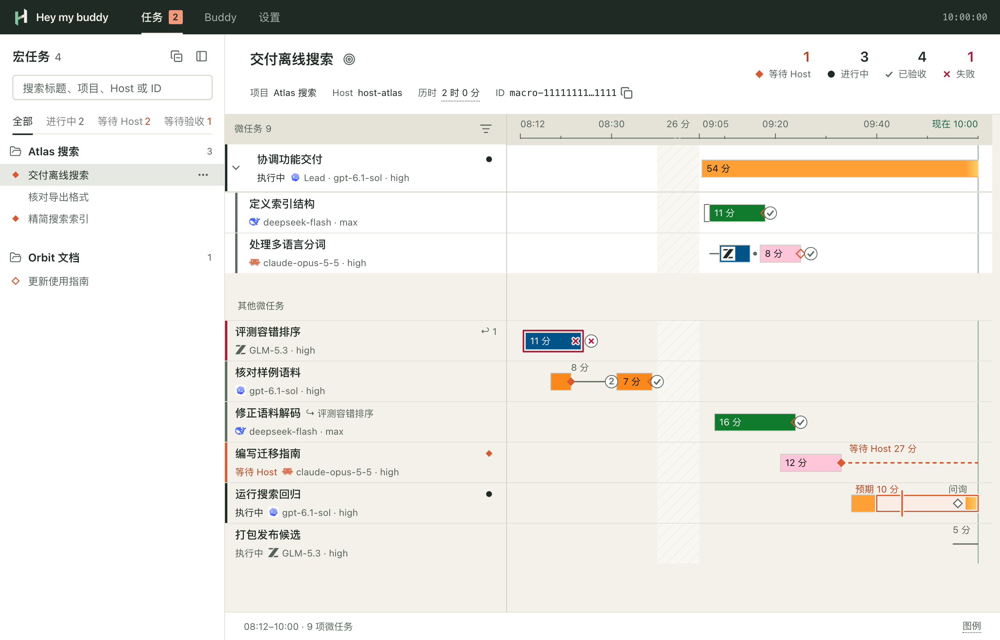
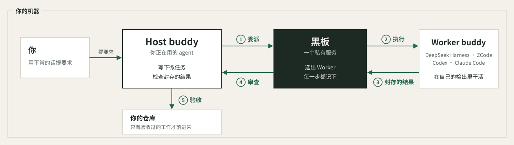
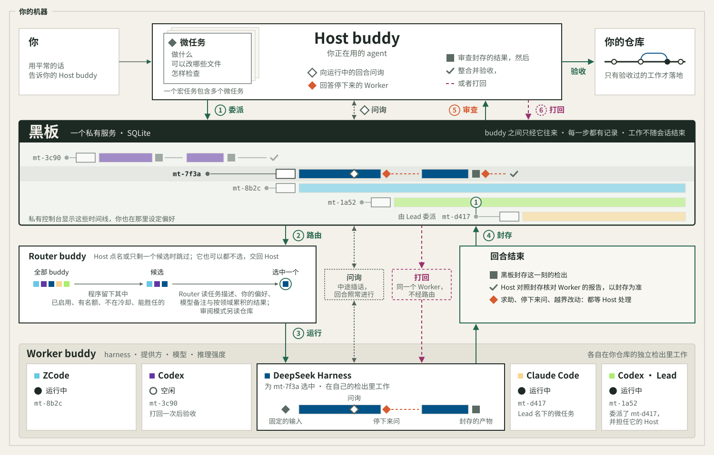

<p align="right"><a href="README.md">English</a> · <strong>简体中文</strong></p>

<picture>
  <source media="(prefers-color-scheme: dark)" srcset="docs/assets/banner-dark.svg">
  
</picture>

<p align="center"><b>工作委派出去，责任留在自己手里。</b></p>

<p align="center">
  你正在用的编码 agent 把边界明确的任务交给本机的其他编码 agent，<br>
  每一份结果都由它核对之后才验收。
</p>

<p align="center">
  <a href="#怎样工作">怎样工作</a> ·
  <a href="#安装">安装</a> ·
  <a href="#开始使用">开始使用</a> ·
  <a href="#现状与限制">现状</a> ·
  <a href="#文档">文档</a>
</p>

---

## hey-my-buddy 是什么

hey-my-buddy 让你正在用的编码 agent 把一部分工作交给本机的其他编码 agent，每一份结果都由它核对之后才落地。

- **你的 agent 始终做主。** 你平常用的编码 agent 就是 *Host buddy*：它拆分工作，把边界明确的部分交给别的 agent，由它决定验收什么。能运行 hey-my-buddy 命令的 agent 都可以当 Host。
- **别的 agent 分头去做。** *Worker buddy* 是在 DeepSeek Harness、ZCode、Codex 或 Claude Code 的 CLI 里运行的编码 agent，用的是你启用的模型与推理强度；每一部分交给谁，由 hey-my-buddy 挑选，或者由 Host 指定。
- **没有核对过的东西不会被验收。** 在 Git 仓库里，每个 Worker 在一份单独的检出里工作；Host 审查结果、跑过检查之后，才会有东西进到你的分支。Worker 也可以不要检出，在你指定的文件夹里工作，适合只要一个回答或一份文档的事；它在那里写下的改动不封存，由 Host 自己去文件夹里看。
- **工作比你的会话活得久。** 终端关掉、连接断开、服务重启都不会取消工作；凭它的标识接着处理。
- **看得见谁在做什么。** 本机私有的控制台把每一项工作画成一条时间线，显示每个 buddy 的负载与你的设置。
- **用你自己配好的 harness。** Worker 跑在你自己的 harness 里，用你的设置、provider、登录、skills、MCP 与 hooks；hey-my-buddy 不改动其中任何一项，也从不保存或转交你的凭据。见[账户与条款](docs/terms.zh-CN.md)。

<picture>
  <source media="(prefers-color-scheme: dark)" srcset="docs/assets/console-timeline-zh-dark.png">
  
</picture>

## 怎样工作

<picture>
  <source media="(prefers-color-scheme: dark)" srcset="docs/assets/overview-zh-dark.svg">
  
</picture>

1. **委派。** Host 写一个*微任务*：做什么、可以改哪些文件、怎样检查，再把它交给*黑板*。黑板是本机的一个服务，每一步都记下来。
2. **执行。** 黑板选出一个 Worker：合格的只有一个就直接用它，有几个就由 *Router buddy* 从中选，Host 也可以点名。Worker 在自己的检出里工作，或者不要检出，在 Host 指定的文件夹里工作。Host 可以向运行中的回合问询；Worker 需要决定时，会停下来问。
3. **封存。** 回合结束时，黑板按当时的样子封存这份检出，结果之后不会再变。不要检出的工作，黑板固定的是 Worker 交回的结果，文件夹里的改动不封存。
4. **审查。** Host 对照微任务审查封存的结果，并跑检查；不对就打回，再跑一个回合，默认还是同一个 Worker，Host 也可以换一个。
5. **验收。** Host 把封存的结果整合进你的仓库并验收；只有验收过的工作才落进仓库。不要检出的工作，验收时不需要整合。

相关的微任务组成一个*宏任务*。完整的流程，包括路由、问询、打回，以及替 Host 继续委派的 *Lead buddy*：

<picture>
  <source media="(prefers-color-scheme: dark)" srcset="docs/assets/architecture-zh-dark.svg">
  
</picture>

细节见[工作流](docs/reference/workflow.md)与[架构](docs/reference/architecture.md)。

## 安装

需要 [uv](https://docs.astral.sh/uv/)；在 Git 仓库里工作还需要 Git 2.40 或更高版本。

```sh
uvx hey-my-buddy@0.61.0 install
```

它把一个共享的 agent skill 装到 `~/.agents/skills/hey-my-buddy`，自带启动器；私有的服务装在 `~/.local/share/hey-my-buddy` 之下（Windows 上是 `%LOCALAPPDATA%\hey-my-buddy`）。它还在 `~/.claude/skills/hey-my-buddy` 放一个指向这个 skill 的链接，Claude Code 从那里找 skill。安装不改你的 `PATH`、shell 与 agent 设置。

也可以从这个仓库的检出构建 wheel 再安装：

```sh
uv build --wheel --out-dir dist
uvx --from "$PWD/dist/hey_my_buddy-0.61.0-py3-none-any.whl" hey-my-buddy install
```

<details>
<summary>或者让你的 agent 来装</summary>

```text
请在这台机器上为我安装 hey-my-buddy。

1. 用我指定的版本，或者我给的 wheel。
2. 在你的沙盒之外、经你自己的权限机制运行安装，不用 sudo。
3. 写入任何东西之前，列出它将创建或替换的每一个路径。
4. 报告 skill 的版本与位置、Claude Code 的链接、服务的动作，以及有没有做备份。
5. 用 ~/.agents/skills/hey-my-buddy/scripts/hey-my-buddy health 核对。
6. 遇到 LAUNCH_ACCESS_DENIED，只放行这一条启动器命令再试；遇到 UPGRADE_NOT_IDLE，报告列出的工作并等待，绝不为了强行升级去取消工作。
```

</details>

升级用同一条命令，换成新版本。改动契约的升级在有工作运行时拒绝，切换之前先做一份核对过的备份。细节、错误码与恢复见[运维](docs/reference/operations.md#installation)。

## 开始使用

用平常的话告诉你的 Host buddy，例如：

> 用 hey-my-buddy 让一个 buddy 检查这份 README 里的链接，报告坏掉的那些。

其余的由 skill 告诉 Host。想自己看看：

```sh
~/.agents/skills/hey-my-buddy/scripts/hey-my-buddy health    # 路由与容量
~/.agents/skills/hey-my-buddy/scripts/hey-my-buddy console   # 打开私有控制台
```

在控制台里启用你想用的 buddy，并设定同时能跑几个。[用法](docs/reference/usage.md)从安装一路讲到验收结果；[命令行参考](docs/reference/cli.md)覆盖每一条命令。

## 现状与限制

- **0.x。** 版本号是 0.x 期间，契约可以在中间那位数字变动时改变；这样的升级会在一次明确的、先做备份的步骤里转换你的黑板。
- **平台。** macOS、Linux 与 Windows 11（x64 与 ARM64）。
- **Harness。** Worker 在 DeepSeek Harness、ZCode、Codex 或 Claude Code 的 CLI 里运行。各个 harness 支持什么、在各个平台上验证到哪一步，见[harness](docs/reference/harnesses.md)。
- **账户与条款。** hey-my-buddy 用的是你自己的 harness 账户与套餐。它怎样使用这些账户、任务的文字会发到哪里、哪些条款适用，见[账户与条款](docs/terms.zh-CN.md)。

## 文档

- [文档索引](docs/README.md)
- [运维](docs/reference/operations.md)：安装、升级、存储、错误码与恢复
- [用法](docs/reference/usage.md)与[命令行](docs/reference/cli.md)
- [控制台](docs/reference/console.md)与[harness](docs/reference/harnesses.md)
- [架构](docs/reference/architecture.md)与[决定](docs/decisions/)

## 开发

```sh
npm --prefix apps/console ci
uv run --frozen python -m hey_my_buddy.cli.checks
npm --prefix apps/console test
```

[AGENTS.md](AGENTS.md) 写明仓库的不变量、目录结构与检查。问题请提到 [GitHub issues](https://github.com/Dsssyc/hey-my-buddy/issues)。

## 许可

[MIT](LICENSE)
